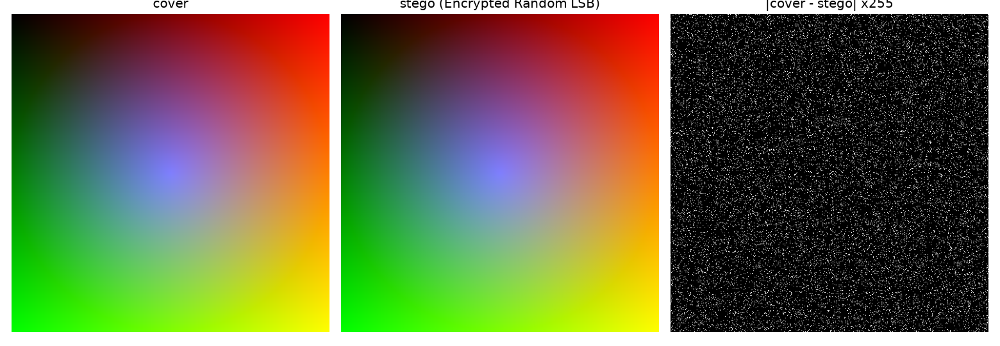
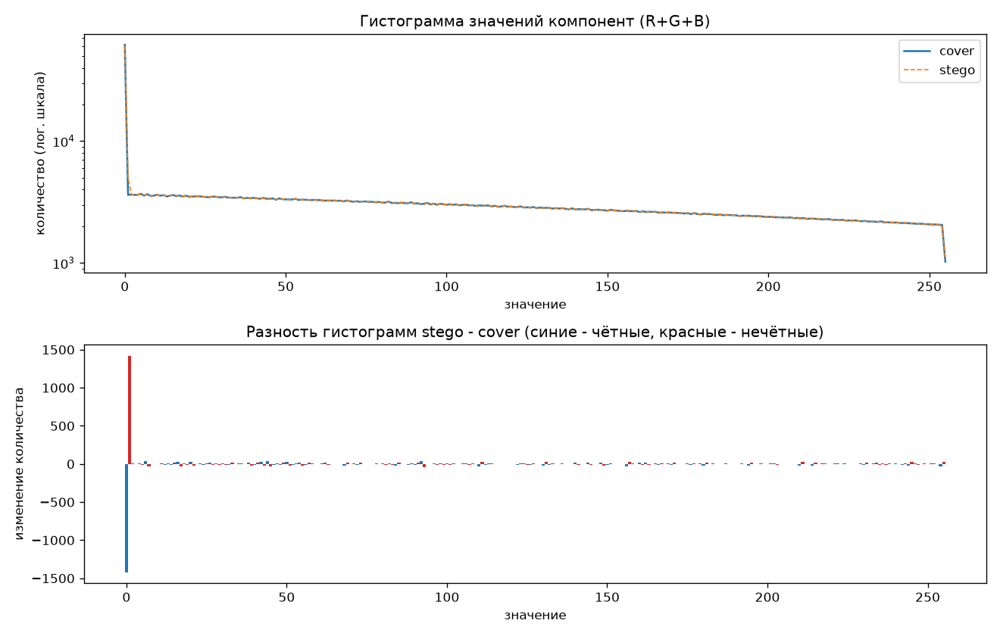

# Отчёт по лабораторной работе №2

## 1. Постановка задачи

Сравнивались три способа спрятать текст в младших битах PNG-картинки:

1. Plain LSB - открытый текст, компоненты обходятся подряд;
2. Encrypted LSB - текст сначала шифруется AES-256-GCM, компоненты обходятся подряд;
3. Encrypted Random LSB - текст шифруется, а компоненты выбираются в псевдослучайном порядке, который зависит от пароля.

Изображения:

- gradient.png (512×512) - гладкий синтетический градиент;
- my_pic.png (256×256) - моё собственное изображение (фото собаки в наушниках);
- checkerboard.png и noise_texture.png (512×512) - прогнаны тем же скриптом, но подробно не разбираются, цифры есть в results/metrics.csv.

Основной эксперимент - на gradient.png и my_pic.png, потому что это два разных типа изображений: искусственная гладкая картинка и реальное фото.

Сообщение - русский текст, повторённый столько раз, сколько нужно для заданного объёма:

Стеганография - это способ спрятать сам факт передачи сообщения. В этой лабораторной текст записывается в младшие биты пикселей картинки.

Пароль: lab2_password.

## 2. Реализация

Код лежит в src/stego.py (встраивание/извлечение/шифрование), src/metrics.py (метрики) и src/experiment.py (эксперимент и графики).

LSB-встраивание. Картинка читается в массив uint8 размера H×W×3 и вытягивается в одномерный массив компонент. Данные переводятся в биты через np.unpackbits. Потом в каждой выбранной компоненте младший бит обнуляется и заменяется битом сообщения: flat[pos] = (flat[pos] & 0xFE) | bits. Каждое значение меняется максимум на 1. Результат сохраняется в PNG (сжатие без потерь, иначе LSB испортились бы).

Длина сообщения. Перед данными пишется 4 байта длины (big-endian): [4 байта длины][данные]. При извлечении сначала читаются первые 32 бита, из них получается длина, потом читается ровно длина × 8 бит.

Проверка вместимости. Вместимость capacity = width × height × 3 бит. Если 32 + 8 × len(data) > capacity, выбрасывается ValueError с текстом вроде «Сообщение не помещается: нужно 1600048 бит, а в картинке есть только 196608 бит», и программа завершается с кодом 1.

Шифрование. Используется pycryptodome:

- ключ 256 бит получается из пароля через PBKDF2-HMAC-SHA256, 200 000 итераций;
- соль 16 байт и nonce 12 байт генерируются случайно при каждом встраивании;
- режим AES-GCM: он заодно даёт тег аутентификации 16 байт, поэтому при неверном пароле расшифрование падает с ошибкой, а не выдаёт мусор.

Служебные данные. В картинку записывается:

[4 байта длины][salt 16][nonce 12][tag 16][ciphertext]

Длина считается для всего, что идёт после неё. Итого служебных данных 48 байт против 4 байт у plain.

Псевдослучайный порядок. Из пароля считается SHA-256("positions:" + пароль), первые 8 байт берутся как seed для numpy.random.default_rng. Генератор делает перестановку permutation(capacity) всех номеров компонент, и данные пишутся по первым позициям этой перестановки. Это перестановка, поэтому одна позиция не может встретиться дважды. При извлечении с тем же паролем получается та же перестановка, так что сначала читаются 32 бита длины по первым 32 позициям, потом остальное. Префикс "positions:" нужен, чтобы seed не совпадал с чем-то ещё, что получается из того же пароля. Ключ AES всё равно получается отдельно, через PBKDF2 с солью.

## 3. Методика эксперимента

- Уровни заполнения: 1% и 5% от вместимости. Для gradient это 983 и 4915 байт, для my_pic - 245 и 1228 байт.
- У всех трёх вариантов одинаковое общее число встраиваемых бит. Plain-вариант не тратит 44 байта на salt/nonce/tag, поэтому его текст на 44 байта длиннее (тот же текст, просто больше повторов). Иначе зашифрованные варианты меняли бы больше компонент, и сравнение было бы нечестным.
- После каждого встраивания извлечённое сообщение сравнивалось с исходным (assert), во всех 24 случаях совпадение полное.
- Метрики:
  - PSNR и SSIM (scikit-image, SSIM по трём каналам);
  - changed_ratio - доля компонент, которые отличаются от cover;
  - P(LSB=0), P(LSB=1) по всем компонентам;
  - χ²-тест по парам (2k, 2k+1). Строится гистограмма значений всех компонент, для каждой пары ожидаемое значение (h[2k] + h[2k+1]) / 2, χ² = Σ (h[2k] − ожидаемое)² / ожидаемое, число степеней свободы = число непустых пар − 1, p-value = chi2.sf. Если в LSB лежат случайные биты, то h[2k] ≈ h[2k+1], χ² маленький и p-value близко к 1. У чистой картинки пары обычно неравные, и p-value близко к 0.
- χ² считался в двух вариантах:
  - по всей картинке (как требуется в задании);
  - по первым payload × capacity компонентам (колонка head), т.е. ровно по той области, куда пишут последовательные методы. Это упрощённая атака Вестфельда; без неё при 1-5% все варианты выглядят одинаково.

## 4. Результаты

### 4.1. Сводная таблица (payload 5%)

gradient.png (cover: P(LSB=1) = 0.4622, χ² = 26053.38, p = 0; χ² по области = 4002.33, p = 0)

| Вариант | PSNR, дБ | SSIM | Изменено компонент | Changed ratio | P(LSB=0) | P(LSB=1) | χ² | p-value | χ² (область) | p-value (область) |
|---|---:|---:|---:|---:|---:|---:|---:|---:|---:|---:|
| Plain LSB | 64.33 | 0.999398 | 18888 | 2.40% | 0.5346 | 0.4654 | 19282.50 | 0 | 412.85 | 6.1·10⁻³² |
| Encrypted LSB | 64.18 | 0.999321 | 19531 | 2.48% | 0.5312 | 0.4688 | 18132.93 | 0 | 61.79 | 1.00 |
| Encrypted Random LSB | 64.18 | 0.999589 | 19536 | 2.48% | 0.5360 | 0.4640 | 23554.52 | 0 | 3628.44 | 0 |

my_pic.png (cover: P(LSB=1) = 0.5004, χ² = 221.18, p = 5.2·10⁻⁹; χ² по области = 54.91, p = 0.89)

| Вариант | PSNR, дБ | SSIM | Изменено компонент | Changed ratio | P(LSB=0) | P(LSB=1) | χ² | p-value | χ² (область) | p-value (область) |
|---|---:|---:|---:|---:|---:|---:|---:|---:|---:|---:|
| Plain LSB | 64.17 | 0.999821 | 4895 | 2.49% | 0.5029 | 0.4971 | 220.15 | 6.8·10⁻⁹ | 126.80 | 2.8·10⁻⁵ |
| Encrypted LSB | 64.20 | 0.999823 | 4862 | 2.47% | 0.4991 | 0.5009 | 209.73 | 8.8·10⁻⁸ | 35.31 | 1.00 |
| Encrypted Random LSB | 64.16 | 0.999840 | 4901 | 2.49% | 0.5001 | 0.4999 | 207.98 | 1.3·10⁻⁷ | 53.70 | 0.91 |

Распределение LSB отдельно:

| Вариант | gradient P(LSB=0) | gradient P(LSB=1) | my_pic P(LSB=0) | my_pic P(LSB=1) |
|---|---:|---:|---:|---:|
| Cover | 0.5378 | 0.4622 | 0.4996 | 0.5004 |
| Plain LSB | 0.5346 | 0.4654 | 0.5029 | 0.4971 |
| Encrypted LSB | 0.5312 | 0.4688 | 0.4991 | 0.5009 |
| Random LSB | 0.5360 | 0.4640 | 0.5001 | 0.4999 |

### 4.2. Два уровня payload

| Изображение | Вариант | PSNR 1% | PSNR 5% | changed 1% | changed 5% | p-value 1% | p-value 5% | p (область) 1% | p (область) 5% |
|---|---|---:|---:|---:|---:|---:|---:|---:|---:|
| gradient | Plain LSB | 71.43 | 64.33 | 0.47% | 2.40% | 0 | 0 | 0.92 | 6.1·10⁻³² |
| gradient | Encrypted LSB | 71.08 | 64.18 | 0.51% | 2.48% | 0 | 0 | 1.00 | 1.00 |
| gradient | Random LSB | 71.12 | 64.18 | 0.50% | 2.48% | 0 | 0 | 2.3·10⁻¹⁰⁰ | 0 |
| my_pic | Plain LSB | 71.21 | 64.17 | 0.49% | 2.49% | 5.0·10⁻⁹ | 6.8·10⁻⁹ | 0.90 | 2.8·10⁻⁵ |
| my_pic | Encrypted LSB | 71.28 | 64.20 | 0.48% | 2.47% | 8.2·10⁻⁹ | 8.8·10⁻⁸ | 0.995 | 1.00 |
| my_pic | Random LSB | 71.25 | 64.16 | 0.49% | 2.49% | 1.5·10⁻⁸ | 1.3·10⁻⁷ | 0.95 | 0.91 |

(cover gradient: p (область) = 8·10⁻¹⁰³ при 1% и 0 при 5%; cover my_pic: 0.93 и 0.89)

### 4.3. Карта разности

gradient.png, Encrypted Random LSB, 5%. Разность умножена на 255, т.е. белая точка значит «компонента изменилась на 1» хотя бы в одном канале.

### 4.4. Гистограмма

Тот же пример. Сверху гистограммы cover и stego (лог. шкала), снизу разность stego − cover.

## 5. Анализ

PSNR / SSIM. При одинаковом payload PSNR у всех методов почти одинаковый: около 64.2 дБ при 5% и около 71.2 дБ при 1%. Каждая компонента меняется максимум на 1, поэтому PSNR зависит только от числа изменений. SSIM везде > 0.999, глазами разницы не видно. На gradient у Random LSB SSIM чуть выше (0.99959 против 0.99932): последовательные методы собирают все изменения в верхних гладких строках, а random распределяет их по всей картинке.

Доля изменённых компонент. Меняется примерно половина встроенных бит (около 2.5% компонент при 5%), потому что в половине случаев новый бит совпадает со старым LSB. У Plain LSB на gradient изменений чуть меньше (2.40%): биты текста не случайные.

Распределение LSB. У зашифрованных вариантов P(LSB=1) почти не меняется (на фото 0.5004 -> 0.5009 и 0.4999). У Plain LSB доля сдвигается к статистике текста (0.4971), то есть открытый текст немного виден уже по доле единиц.

χ² и p-value. По всей картинке при 1-5% p-value у всех вариантов ≈ 0, как у cover, значит тест встраивание не обнаруживает. По области встраивания методы различаются: у Encrypted LSB p = 1 (пары выровнены, встраивание обнаружено), у Plain LSB статистика тоже искажается, но по-другому, а у Random LSB χ² и p-value почти как у cover.

Влияние шифрования. На PSNR и SSIM не влияет. Шифрование прячет содержание и убирает перекос текста в LSB, но при последовательной записи χ² всё равно находит встраивание.

Влияние псевдослучайного размещения. На PSNR и число изменений не влияет, но изменения рассеиваются по всей картинке (это видно на карте разности), поэтому локальный χ²-анализ ничего не находит.

Влияние payload. При переходе от 1% к 5% изменений становится примерно в 5 раз больше, PSNR падает примерно на 7 дБ (71.2 -> 64.2), а χ² по всей картинке уменьшается сильнее (у encrypted на gradient на 10% и на 30%). Статистические отличия растут вместе с объёмом данных.

## 6. Итоговый вывод

1. Визуально все три метода одинаково незаметны: PSNR > 64 дБ, SSIM > 0.999. PSNR определяется только числом изменённых компонент (≈ половина встроенных бит), поэтому методы по нему практически не различаются.
2. Шифрование не ухудшает картинку и делает биты сообщения похожими на случайные: доля LSB=1 не смещается к статистике текста, как у Plain LSB.
3. При последовательном встраивании шифртекста χ² по области встраивания даёт p = 1, т.е. встраивание обнаруживается. Открытый текст тоже меняет статистику этой области, только по-другому.
4. Псевдослучайное размещение - единственный из трёх способов, у которого локальная статистика осталась как у исходной картинки. По всей картинке простой χ²-тест при 1-5% не обнаруживает ни один из методов.
5. С ростом payload изменения растут линейно, PSNR падает (−7 дБ при ×5), а статистические отличия становятся заметнее. Поэтому чем меньше заполнение, тем труднее обнаружение.

Лучший по совокупности вариант - Encrypted Random LSB: содержание защищено шифром, а изменения рассеяны так, что простой χ²-анализ их не видит.
